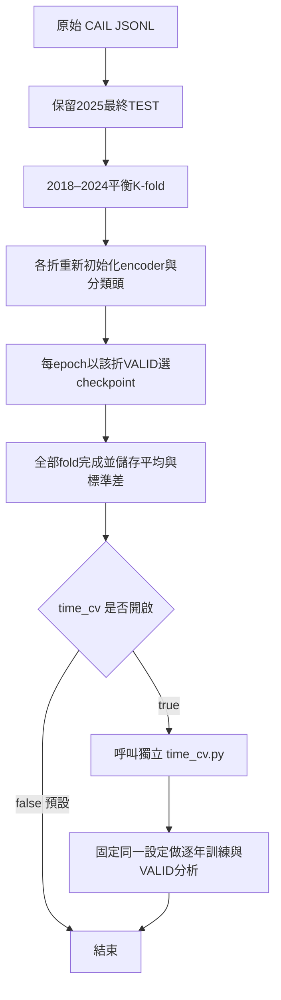

# 目前模型與訓練入口

主入口是 `train_model.py`。Grid Search已完成，預設不再搜尋，最佳設定已寫進 `configs/accusation_cv_electra.json`；搜尋呼叫只保留為主程式中的註解範例。

## 控制流程



Time CV呼叫在**主要模型全部驗證與彙整完成之後**，不是每個epoch、每個fold都重跑；主要驗證未完整完成時不會啟動。每個時間切分重新訓練，沒有內層K-fold或grid搜尋。2025在兩種流程都不評分。

## 模型架構與預設

判決fact → 相同encoder的tokenizer → 最多512 tokens → 法律ELECTRA → CLS 768維 → Linear 512／ReLU／Dropout → Linear 256／ReLU／Dropout → 類別數。

- Encoder：`hfl/chinese-legal-electra-base-discriminator`，revision固定為 `ffd97a559532e03a0073d2cdfede81a8a7f6d361`。
- 凍結embeddings與前十層，只微調最後兩層及MLP分類頭。
- 罪名／法條為多標籤：BCEWithLogitsLoss、sigmoid門檻0.5。輸出維度依各折TRAIN manifest建立，不固定為調參時的19類。
- 已驗證的調參最佳值：encoder LR=2e-5、dropout=0.1；其餘head LR=1e-3、weight decay=0.01、batch=4、grad_accum=4、pos_weight cap=10、seed=42。
- 主實驗預設5-fold × 最多5 epochs、patience=2；可改10-fold或3 epochs。每折重新初始化，不能沿用調參checkpoint。
- 分折兼顧多標籤、月份與筆數；同案／文件／相同事實群組不可拆。每折只從自己的TRAIN建立類別與權重。

## 使用方式

在 `model/` 目錄執行，先安裝 `requirements.txt`。所有設定中的路徑以目前工作目錄為準；資料與輸出請替換成自己的路徑。

```bash
# 只印設定，不讀取資料、不下載模型、不訓練
python train_model.py --print-config

# 5-fold × 最多5 epochs；Time CV預設關閉
python train_model.py --data /本機路徑/資料.jsonl --output runs/accusation_5fold

# 5-fold × 最多3 epochs
python train_model.py --data /本機路徑/資料.jsonl --output runs/accusation_5fold_3epoch --epochs 3

# 10-fold；主要驗證完成後才額外跑Time CV
python train_model.py --data /本機路徑/資料.jsonl --output runs/accusation_10fold_time --folds 10 --time-cv
```

`configs/accusation_experiment.json` 集中設定資料、folds、epochs、precision、`time_cv: false`；模型超參數另讀training_config指向的檔案。CLI同名參數優先，`--no-time-cv`可覆蓋JSON中的true。

Time CV也可額外獨立執行，應提供已固定的同一套設定：

```bash
python -m judgment_bert.time_cv --data /本機路徑/資料.jsonl \
  --config configs/accusation_cv_electra.json --output runs/accusation_time_analysis
```

時間分析依序2018→2019、2018–2019→2020，直到2018–2023→2024。各年份仍以該年VALID選checkpoint，因此是額外驗證分析，不是未參與任何選模的獨立TEST。

## 混合精度

`precision`預設`fp32`；不會自動開啟AMP。可自行選擇：

```bash
python train_model.py --data /本機路徑/資料.jsonl --output runs/accusation_bf16 --precision bf16
# 或 --precision fp16
```

- `fp16`：autocast＋GradScaler；先unscale再裁剪梯度；發生overflow而跳過optimizer step時，也跳過scheduler step。
- `bf16`：autocast，不使用FP16梯度縮放。
- 訓練與VALID採相同precision；轉NumPy計分前轉回FP32，避免BF16不能直接轉NumPy的問題。權重仍以FP32儲存，沒有直接將整個模型 `.half()`。

已在本機M4、macOS 26.6.2、PyTorch 2.8.0，以tiny ELECTRA＋MLP驗證MPS FP16／BF16的forward、backward、optimizer step及評估。這證明**目前環境可執行**，不代表所有PyTorch／macOS版本均支援，也不代表正式模型一定更快或得到相同分數。舊環境請先升級或跑小規模測試；CUDA尚未在本次機器實測。

AMP會自動為不同運算選擇精度；FP16通常搭配梯度縮放，實作依[PyTorch 2.8 AMP文件](https://docs.pytorch.org/docs/2.8/amp.html)與[AMP範例](https://docs.pytorch.org/docs/2.8/notes/amp_examples.html)。MPS精度條件亦見[PyTorch 2.8 autocast原始碼](https://github.com/pytorch/pytorch/blob/v2.8.0/torch/amp/autocast_mode.py)。

## 產物與範圍

`experiment_config.json`及`training_config.json`保存實際入口設定；`main/cv_summary.json`保存主驗證結果；只有time_cv開啟時才建立 `time_cv/`；`experiment_summary.json`彙整主要及額外結果。已存在的實驗目錄不覆寫。

現在沒有啟動正式CV，等待約20萬筆新資料。先前Grid Search結果見 [GRID_SEARCH_RESULTS.md](GRID_SEARCH_RESULTS.md)，FP32估時見 [TRAINING_ESTIMATES.md](TRAINING_ESTIMATES.md)。調參樣本若再進入CV，分數可能有選模偏樂觀；資料上游既有全年度選樣限制也仍需揭露。新資料須重新建立切分、類別與pos_weight，不能將2018小樣本的最佳設定視為20萬筆已驗證的最佳值。
