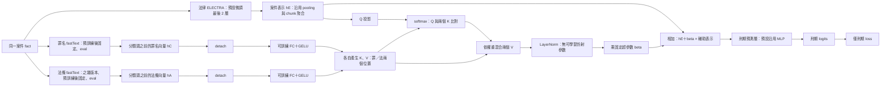

# 刑期主路徑＋固定罪法 fastText：之幾法條版本

狀態：2026-10-28，已實作模型、案件向量匯出／載入器與單 fold 訓練入口；見 [向量檔工作流程](FASTTEXT_VECTOR_WORKFLOW.md)。本機罪法 fastText 已完成 5-fold 訓練與匯出；正式 ELECTRA 訓練留待 Kaggle，不在本機啟動。

模型：`judgment_bert/term_fusion.py` 的 `FrozenFastTextTermModel`。
此階段是利用固定罪法表示的刑期特徵融合，不是三個 loss 聯合更新的 MTL，也不是以預測分數作輸入的 stacking。

## 架構圖



Q、K、V 都由同一次 forward 的表示各自計算。沒有前一次 query、沒有先預測刑期再餵回網路。
attention 是對「罪／法兩個來源」分配每案權重，不是對 token 或每個向量維度做 attention。

## 計算與梯度

令 H 為 ELECTRA hidden size、D 為 attention dimension：

```text
hC: [B, accusation_dim] → detach → FC+GELU → uC: [B, H]
hA: [B, article_dim]    → detach → FC+GELU → uA: [B, H]
sources = stack(uC, uA)                     : [B, 2, H]
Q = WQ(hE)                                 : [B, 1, D]
K = WK(sources)                             : [B, 2, D]
V = WV(sources)                             : [B, 2, H]
alpha = softmax(sum(Q * K, dim=-1)/sqrt(D))  : [B, 2]
r = sum(alpha * V, source_axis)             : [B, H]
z = hE + beta * LayerNorm(r)                : [B, H]
logits = term_head(z)                       : [B, num_labels]
```

- fastText 不放進本模型或 optimizer；抽取向量時使用各自最佳 checkpoint、`eval()` 與 `torch.no_grad()`。輸入向量在 FC **之前**再次 detach。
- 刑期 loss 更新罪法 FC、Q/K/V、刑期預測層，以及設定允許微調的 ELECTRA 層。固定罪法 encoder 與原分類頭不更新。
- beta 預設 0.1，只是起始超參數；以 buffer 隨 state_dict 保存，不由 optimizer 更新。可比較 0、0.05、0.1、0.2，以刑期 VALID 表現選擇，不能用 TEST 選 beta。
- beta=0 精確回到同一 ELECTRA／預測層的無輔助路徑。LayerNorm 只控制輔助表示尺度；beta 或 alpha 都不是預測貢獻百分比。
- 不加入罪法 loss，不使用 Auto-Lambda。本版沒有將兩個 fastText 改為可聯合更新的 encoder。
- `return_attention=True` 回傳 `(logits, alpha)`，alpha 的來源順序固定為 `[accusation, article]`；預設只回傳 logits。

## 之幾資料約定

使用工作區內的共用資料包：

`deliverables/shared_100k_with_sentence_suffix_20261026/shared_100k_sentence_article_suffix/`

- 事實與刑期：`shared_100k_with_article_suffix.jsonl` 的 fact 與既有刑期欄位。
- 法條 fastText 的訓練目標必須是 `meta.relevant_articles_with_suffix`，使用 `fixed_classes_suffix.json` 的法條名單（109 類），不可誤用 `meta.relevant_articles` 的粗標籤。
- 罪名沿用共用包的罪名類別名單；刑期 `num_labels` 由最後採用的刑期 manifest 決定，本架構不硬寫刑期分組，不把拘役當成 0 月有期徒刑。
- 維持 `shared_fold_assignments.csv` 的各 fold 角色、purged 案件與 2025 holdout。fastText 只能用對應 fold 的 TRAIN 訓練；不能讓刑期 TEST／holdout 案件或標籤進入 fastText 訓練。
- 對齊向量用 jid／原始 sample line，不在篩掉案件後直接靠陣列位置猜配對。罪法向量只從 fact 計算，刑期 forward 不讀真實罪名或法條。
- 不同 fold 的獨立 fastText 向量座標不保證一致；每個刑期 fold 應綁定自己的兩個固定 fastText checkpoint，不能直接混接不同模型的隱向量。
- 109 類名單沿用既有 2016–2025 頻率政策，不宣稱是 past-only；原資料與 fold 不在本次變更中重寫。

## 接入方式

在 `JudgementDigest/model/` 的 Python 環境使用：

```python
from judgment_bert.term_fusion import FrozenFastTextTermModel

# 維度從完成訓練的兩個 fastText checkpoint 取得；不可把類別數當成隱向量維度。
model = FrozenFastTextTermModel(
    num_labels=term_manifest['num_labels'],
    accusation_dim=accusation_vectors.shape[-1],
    article_dim=article_vectors.shape[-1],
    beta=0.1,
    attention_dim=128,
    revision='ffd97a559532e03a0073d2cdfede81a8a7f6d361',
)
logits, alpha = model(
    input_ids=batch['input_ids'],
    attention_mask=batch['attention_mask'],
    accusation_vectors=accusation_vectors,
    article_vectors=article_vectors,
    chunk_mask=batch.get('chunk_mask'),
    return_attention=True,
)
```

所有輸入放在相同 device；罪法向量為有限浮點 tensor `[batch, feature_dim]`。既有本機 fastText GPU 程式的候選特徵是 eval 模式下 EmbeddingBag 的判決向量，不是 logits；最終仍以實際產出的 checkpoint 與 preprocessing 設定核對。

後續接 trainer 時，encoder 使用既有 encoder LR；**所有**非 encoder 可訓練參數（含新投影、Q/K/V）都要進 optimizer，不能只加入 `model.head.parameters()`。loss、刑期評估／選模方式應與刑期單任務 baseline 一致。

`train_model.py` 的整套 CV 入口仍未新增融合參數。單 fold 的 `python -m judgment_bert.train` 已支援 `--fasttext-vectors`、`--fasttext-fold`、`--fusion-beta` 與 `--fusion-attention-dim`；完整指令見向量檔工作流程。此文件範例只示範模型介面。

離線測試（不需 fastText／預訓練權重／資料集）：

```sh
python -m unittest discover -s tests -p test_term_fusion.py -v
```

本次驗證：新增架構測試 5 項、既有 `test_baseline.py` 14 項全部通過。涵蓋罪法輸入無梯度、投影與 Q/K/V 有梯度、encoder 凍結範圍、beta=0 回復無輔助路徑、輔助向量影響輸出、chunk padding 與輸入驗證。使用本機 tiny ELECTRA，沒有下載權重或進行真實資料訓練。
